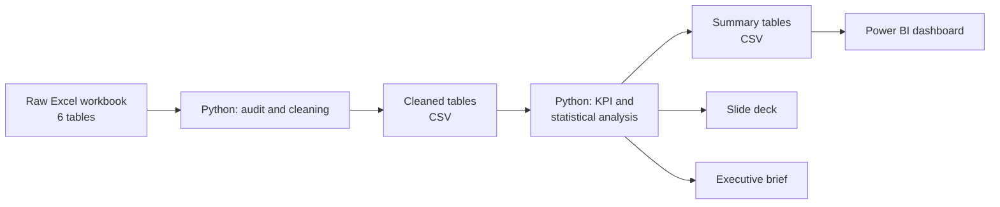
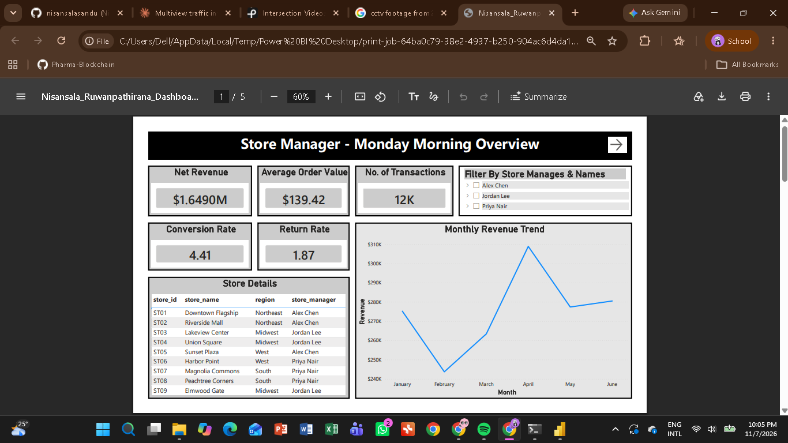
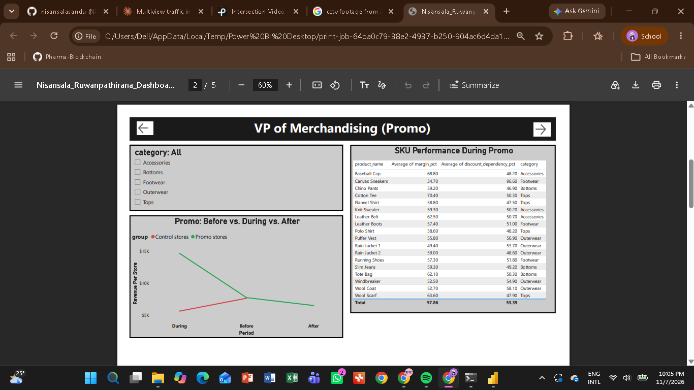
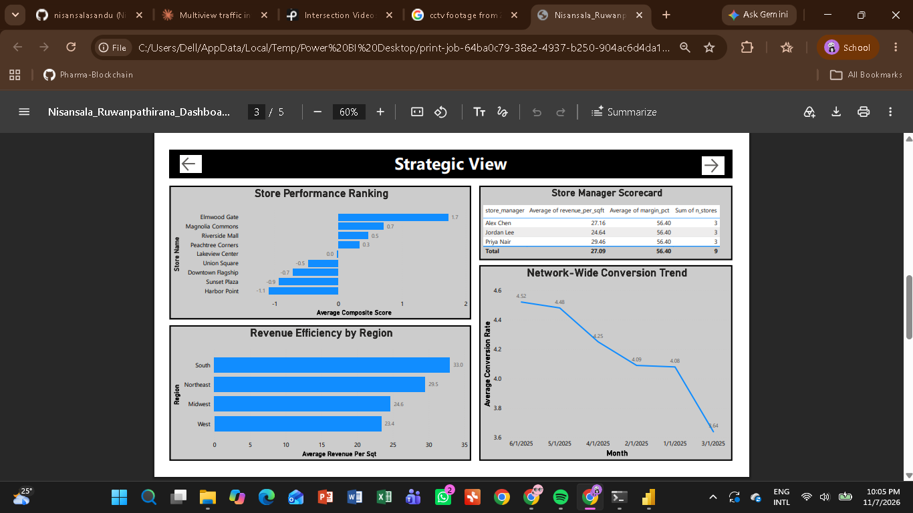
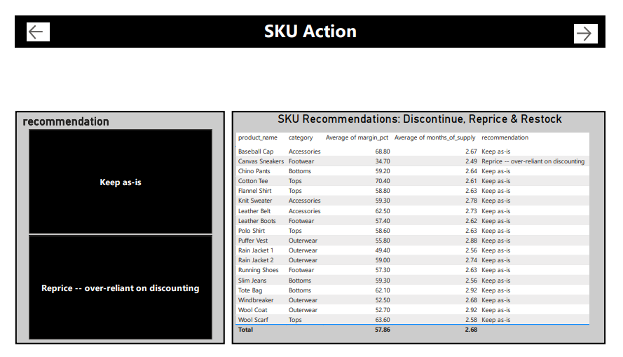
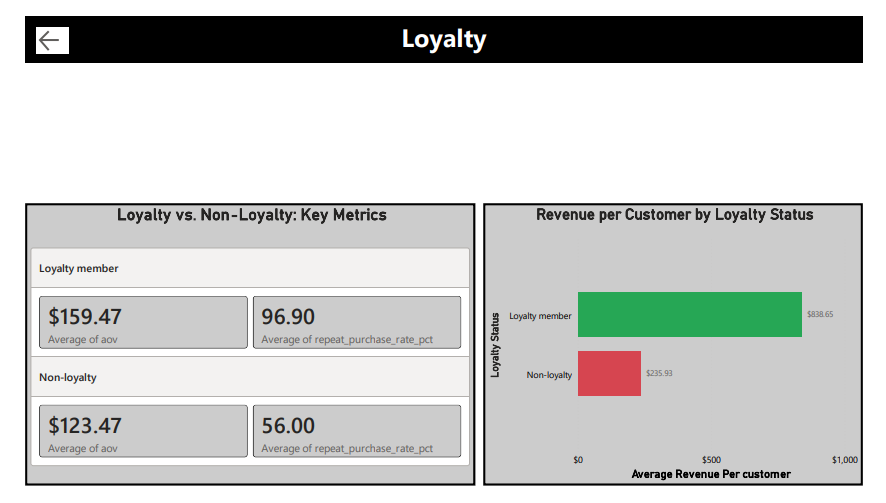

# Retail Apparel Performance Analysis

An end-to-end retail analytics project: clean and validate six months of multi-store apparel data in Python, answer 10 business questions with KPIs and statistical tests, and present the results through a Power BI dashboard, a slide deck and an executive brief.


## Table of Contents

1. [Project Overview](#project-overview)
2. [Business Questions](#business-questions)
3. [Dataset Details](#dataset-details)
4. [Architecture](#architecture)
5. [Methodology](#methodology)
6. [Key Findings](#key-findings)
7. [Conclusion](#conclusion)
8. [Recommendations](#recommendations)
9. [Limitations](#limitations)
10. [Repository Structure](#repository-structure)
11. [Setup and Installation](#setup-and-installation)
12. [Author](#author)

## Project Overview

A retail apparel business wants to understand how its stores, products, promotions and customers performed from January to June 2025. The analysis covers 9 stores across 4 regions (two stores opened or closed mid-period) and is aimed at three audiences: store managers, the VP of Merchandising and senior operations leadership.

| | |
|---|---|
| **Period** | Jan–Jun 2025 |
| **Scope** | 9 stores, 4 regions, multiple product categories |
| **Tools** | Python (pandas, NumPy, SciPy, Matplotlib), Jupyter, Power BI |
| **Deliverables** | Jupyter notebook, Power BI dashboard, slide deck, executive brief |

## Business Questions

1. How would you assess overall store performance?
2. What distinguishes a genuine underlying problem from a temporary bad month?
3. How effective have the promotions been?
4. Are there SKUs to discontinue or reprice?
5. Are prices competitive against the market in each category?
6. Is the loyalty programme delivering value?
7. What can be concluded about customer conversion rates?
8. Which SKUs are under-stocked or over-stocked?
9. How is store allocation distributed geographically?
10. How should store managers be evaluated?

## Dataset Details

The source is a single Excel workbook (`Retail_Apparel_Data_v1.xlsx`) with six tables. The raw file is not included in this repository.

| Table | Description |
|---|---|
| `transactions` | Line-level sales: order date, store, product, quantity (negative values are returns), discount %, customer ID |
| `stores` | Store master data: region, manager, square footage, open and close dates |
| `products` | Product master data: SKU, category, cost price |
| `daily_foot_traffic` | Daily visitor counts per store, used for conversion rate |
| `inventory_snapshot` | Stock on hand per store and SKU, used for months-of-supply |
| `promo_calendar` | Promotion windows, discount depth, category and participating stores |

**Data quality issues found and fixed**

| Issue | Treatment |
|---|---|
| 347 exact-duplicate transaction rows | Removed (20,774 to 20,427 lines) |
| Date format stated as DD/MM/YYYY, but the data is MM/DD/YYYY | Validated against the Jan–Jun window, corrected and flagged |
| 40 text variants of 9 store names | Standardised using the clean `store_id` |
| Two product codes (P001, P010) sharing the name "Rain Jacket" | Renamed distinctly |
| 2 products missing a category | Backfilled from the recorded category for that product |
| 437 missing discount values, 9 missing customer IDs | Imputed, with every imputed row flagged |
| 329 negative quantities | Kept as legitimate returns, not errors |
| Stale pre-computed revenue column | Dropped and recomputed after cleaning |

## Architecture




The notebook handles everything up to the exported summary tables. Power BI imports those pre-built KPI tables, so the dashboard stays light and the calculations stay reproducible in code.

## Methodology

**1. Audit and clean.** Quantify nulls, duplicates and dtype problems per table, then fix each one with a documented decision. Check that every `store_id` and `product_id` in transactions exists in the master tables before joining.

**2. Engineer metrics.** Merge cost price into transactions to compute net margin per line. Normalise store metrics by days open and square footage so stores of different size and age compare fairly.

**3. Analyse each question with a suitable method.**

| Question | Approach |
|---|---|
| Store performance | Composite score from z-scored revenue per sq ft per day, conversion rate and margin |
| Real problem vs bad month | Linear-regression trend slope across six months versus single-month z-scores |
| Promotion effectiveness | Difference-in-differences against non-promo control stores, with a t-test |
| SKU actions | ABC revenue classification combined with margin, return rate and discount dependency |
| Competitive pricing | Margin-outlier proxy, because no external market prices exist |
| Loyalty value | Average order value, frequency and repeat rate compared across groups, with a t-test |
| Conversion | Unique transactions divided by foot traffic, tracked monthly |
| Inventory balance | Months of supply at store and SKU level |
| Geographic allocation | Revenue, square footage and traffic rolled up by region |
| Manager evaluation | Revenue per square foot managed, so managers with different store sizes compare fairly |

**4. Communicate.** Build a Power BI dashboard with tailored views for each audience, a slide deck for the full story, and a one-page executive brief for the single biggest decision.











## Key Findings

- **Spring Outerwear promotion worked.** Promo stores rose **+88.9%** in revenue per store while control stores fell **-26.2%** over the same window, with **+$14,585** in margin gained (t = 5.54, p < 0.0001).
- **Store performance** differs meaningfully once size is controlled for. The composite score ranks stores on efficiency rather than footprint.
- **Harbor Point shows a genuine decline** across all six months (about -7.5% of its average per month), while Elmwood Gate, which opened in April, has too little history to judge.
- **Canvas Sneakers is the weakest SKU:** 34.7% margin, the lowest of any product, with 96.6% of its revenue sold on discount. Footwear has the widest margin spread of any category.
- **Loyalty members are worth more:** average order value of $159 vs $123 (+29%) and a repeat purchase rate of 96.9% vs 56.0%, both statistically significant.
- **Conversion is improving,** rising from 4.08% in January to 4.52% in June.
- **Inventory is misaligned:** Elmwood Gate carries 5.7–7.0 months of supply on nearly every SKU, while Polo Shirt, Slim Jeans and Flannel Shirt run under 2.2 months at Harbor Point, Magnolia Commons and Peachtree Corners.
- **Regional efficiency:** the South earns the most revenue per sq ft and the West the least. Managers run at roughly equal margin (~56%), so gaps come from operating efficiency rather than product mix.


## Conclusion

The data shows a business that is broadly healthy, with a clear, evidence-backed win in the Spring Outerwear promotion, a rising conversion rate and a loyalty programme that clearly pays for itself. The main weaknesses are specific and fixable rather than systemic: one store in structural decline, a thin-margin footwear line that depends on discounts, and inventory that does not match demand at several stores. Because the promotion was tested against a control group, its lift can be attributed to the promotion itself rather than to seasonality.

## Recommendations

1. **Repeat the Spring Outerwear promotion** at the next seasonal changeover, using the same 25% discount, 3-week window and initial rollout stores. Pre-stock two weeks ahead, re-run the same difference-in-differences test when it closes, and consider extending it to adjacent categories.
2. **Reprice Canvas Sneakers** and audit other high discount-dependency SKUs in Footwear, where margin spread is widest.
3. **Rebalance inventory.** Reduce Elmwood Gate's stock as real demand data accumulates, and prioritise replenishing fast movers at Harbor Point, Magnolia Commons and Peachtree Corners.
4. **Intervene at Harbor Point,** and review Elmwood Gate again after another quarter of data.
5. **Invest in loyalty.** Members spend more and return far more often, so growing enrolment is likely worth the cost.
6. **Review space allocation** in the lowest-efficiency regions, starting with the West.
7. **Close the data gaps:** add competitor pricing, SKU-level sell-through and a longer post-promotion window to firm up pricing and promo conclusions.

## Limitations

- Competitive pricing (Q5) cannot be answered properly without external market-price data, so an internal margin-outlier proxy is used.
- Only one promotion appears in the data, and the post-promo period is short. Another month would show whether the post-event dip is a return to baseline or a pull-forward effect.
- Elmwood Gate has only three months of history, so conclusions about it are tentative.
- Promo lift was not broken down by SKU, so it may be concentrated in a few products.

## Repository Structure

```
.
├── 01_cleaning_and_kpi_analysis.ipynb      # Data cleaning and KPI analysis (Q1-Q10)
├── retail_apparel_dashboard.pbix           # Power BI dashboard
├── retail_apparel_performance_review.pdf          # Slide deck   
├── executive_brief_spring_outerwear_promo.pdf     # Executive brief
├── images/                                     # README images (image01.png ... image05.png)
├── Retail_Apparel_Data_v1.xlsx
├── LICENSE
└── README.md
```

## Setup and Installation

**Prerequisites:** Python 3.9+, Git, and Power BI Desktop (Windows) for the dashboard.

1. **Clone the repository**
   ```bash
   git clone https://github.com/<your-username>/retail-apparel-performance-analysis.git
   cd retail-apparel-performance-analysis
   ```
2. **Create a virtual environment**
   ```bash
   python -m venv .venv
   source .venv/bin/activate        # Windows: .venv\Scripts\activate
   ```
3. **Install dependencies**
   ```bash
   pip install -r requirements.txt
   ```
4. **Add the data.** Place `Retail_Apparel_Data_v1.xlsx` in the `data/` folder.
5. **Run the notebook**
   ```bash
   jupyter notebook notebooks/01_cleaning_and_kpi_analysis.ipynb
   ```
   The notebook exports the cleaned tables and the KPI summary tables used by the dashboard. Check the first cells for input and output paths and adjust them if needed.
6. **Open the dashboard.** Open `dashboard/retail_apparel_dashboard.pbix` in Power BI Desktop. If data sources show errors, repoint them to your exported CSVs under *Transform data > Data source settings*.

## Author

**Nisansala Ruwanpathirana**
Data science intern | [LinkedIn](https://www.linkedin.com/in/your-profile) | [GitHub](https://github.com/your-username)

Released under the MIT License. See [LICENSE](LICENSE).
